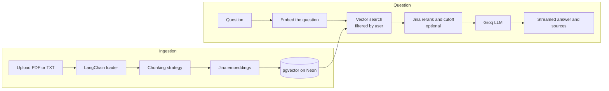

# RAG Chatbot
<p align="center"></p>

A retrieval-augmented generation (RAG) app with configurable chunking, vector search and optional reranking. Upload PDF or text files, choose how they are split into passages, and get answers that come **only** from what you uploaded, with the exact passages shown so you can check them.

**Live demo:** https://raggg.vercel.app

> The API runs on a free Render instance, so the first request after a quiet period can take up to a minute while it wakes up.

<!--
Add screenshots after you take them, then remove this comment:


-->

## What it does

The app walks through the three stages of a RAG pipeline, and you control the first one.

1. **Chunk:** upload a PDF or TXT file and choose a chunking strategy (recursive, fixed size, sentence-aware or paragraph-based) with your own size and overlap. The passages are embedded and stored in pgvector.
2. **Retrieve:** your question is embedded and matched against your passages only. Optional reranking re-scores the candidates and drops weak matches.
3. **Generate:** a streamed answer is written from the retrieved passages, with the sources listed underneath.

If your documents don't contain the answer, the assistant says so instead of guessing.

## Features

- **Accounts:** email and password sign-up with a 6-digit email verification code, and a forgot-password flow.
- **Private by design:** every search is filtered by your user id inside the database query, so you never see another user's documents.
- **Uploads:** PDF and TXT with size, page and passage limits. Processing runs in the background with live status.
- **Chunking strategies:** recursive, fixed size, sentence-aware or paragraph-based, with adjustable size and overlap, chosen per upload.
- **Optional reranking:** a toggle in the chat re-scores the retrieved passages for relevance, and a calibrated cutoff drops weak matches.
- **Streaming answers** with Markdown and tables, a Stop button, and source passages with chunk numbers.
- **Saved conversations:** list, rename, delete, and reopen any chat from its link.
- **Database tab:** browse and search the passages stored from your uploads.
- **Themes:** light, dark or follow the system.
- **Admin status panel** (for emails listed in `ADMIN_EMAILS`): health of the embedding, LLM and email services, and an estimated token balance.
- **Free-tier protection:** per-user quotas, daily message limits, login rate limiting, and a switch to close sign-ups.

## Tech stack

| Layer | Technology |
|---|---|
| Frontend | Next.js 16 (App Router), React, TypeScript, Tailwind CSS, react-markdown |
| Backend | FastAPI, SQLAlchemy, Pydantic |
| RAG framework | LangChain (document loaders, text splitters, PGVector store, Groq chat model, prompt templates) |
| Database | PostgreSQL with pgvector, hosted on Neon |
| Embeddings | Jina `jina-embeddings-v5-omni-small` (1024 dimensions), via API |
| Reranking | Jina `jina-reranker-v3.5`, via API |
| LLM | Groq `openai/gpt-oss-120b` |
| Email | Gmail API (OAuth2 refresh token) |
| Auth | JWT and bcrypt |
| Hosting | Render (API), Vercel (web) |

Embeddings, reranking and answers all run through hosted APIs, so the backend stays small enough for a free 512 MB instance.

## How it works



- **Ingestion:** the file is saved to a temporary location, loaded, split with the chosen strategy, embedded in batches, and stored with metadata (user, document, source, chunk number). The temporary file is always deleted. Documents interrupted by a restart are marked as failed on the next startup.
- **Retrieval:** the question is embedded and compared against your stored passages. With reranking on, Jina re-scores the candidates and passages below a calibrated relevance cutoff are dropped. If nothing relevant remains, the LLM is not called at all.
- **Generation:** the LLM is told to answer only from the supplied passages, to say so when the answer is missing, and to treat the passages as untrusted text.

## Project structure

```
backend/
  app/
    main.py            FastAPI app, CORS, startup checks, /health, /config
    routers/           auth, documents, chat, sessions, chunks, admin
    rag/               chunking, embeddings, ingest, retrieve, rerank, chat, status
    services/email.py  Gmail and console email senders
  scripts/             calibrate_rerank.py
  tests/               pytest suite (uses fakes, no external calls)
frontend/
  src/app/             login, dashboard, documents, chat, database
  src/components/      shared UI
  src/lib/             API client, chat streaming, upload config
```

## Run it locally

You need Python 3.13, Node.js 20 or newer, a Postgres database with the pgvector extension (a free [Neon](https://neon.tech) project works), a [Jina](https://jina.ai) API key and a [Groq](https://console.groq.com) API key.

**Backend**

```bash
cd backend
python -m venv venv
venv\Scripts\activate          # Windows
# source venv/bin/activate     # macOS / Linux
pip install -r requirements.txt
copy .env.example .env         # macOS / Linux: cp .env.example .env
# fill in .env (see below), then:
uvicorn app.main:app --reload --port 8000
```

The API is at http://localhost:8000 and interactive docs are at http://localhost:8000/docs. Tables are created automatically on startup.

**Frontend**

```bash
cd frontend
copy .env.local.example .env.local    # macOS / Linux: cp .env.local.example .env.local
npm install
npm run dev
```

Open http://localhost:3000. With `EMAIL_BACKEND=console`, verification and reset codes are printed in the backend terminal, so you can sign up without an email provider.

## Configuration

Set these in `backend/.env`. The full list with defaults is in `backend/.env.example`.

| Variable | Purpose |
|---|---|
| `DATABASE_URL` | Postgres connection string, in the form `postgresql+psycopg://...` |
| `JWT_SECRET` | Long random string used to sign login tokens |
| `JINA_API_KEY`, `JINA_EMBEDDING_MODEL`, `EMBEDDING_DIMENSION` | Embeddings and reranking |
| `GROQ_API_KEY`, `GROQ_MODEL` | Answer generation |
| `EMAIL_BACKEND`, `GMAIL_CLIENT_ID`, `GMAIL_CLIENT_SECRET`, `GMAIL_REFRESH_TOKEN`, `GMAIL_USER`, `EMAIL_FROM_NAME` | `console` prints codes locally, `gmail` sends real email via Gmail API |
| `RERANK_ENABLED`, `RERANK_MIN_SCORE`, `RETRIEVAL_CANDIDATES`, `RERANK_TOP_N` | Reranking and how many passages reach the LLM |
| `MAX_MESSAGES_PER_DAY`, `MAX_DOCUMENTS_PER_USER`, `MAX_TOTAL_CHUNKS_PER_USER`, `MAX_UPLOAD_MB` | Per-user limits |
| `FRONTEND_ORIGINS`, `TRUST_PROXY`, `SIGNUPS_ENABLED`, `ADMIN_EMAILS` | Hosting and access |

The frontend needs one variable in `frontend/.env.local`: `NEXT_PUBLIC_API_URL` (for example `http://localhost:8000`).

**Tuning the reranker cutoff.** Relevance scores are not probabilities and depend on your documents, so calibrate `RERANK_MIN_SCORE` on your own data:

```bash
cd backend
python -m scripts.calibrate_rerank --email you@example.com
```

## Tests

```bash
cd backend
python -m pytest -q          # uses fakes, makes no real API calls

cd ../frontend
npm run lint
npm run build
```

## Deployment

- **Backend on Render:** root directory `backend`, build command `pip install -r requirements.txt`, start command `uvicorn app.main:app --host 0.0.0.0 --port $PORT`, health check path `/health`. Add the environment variables above, set `TRUST_PROXY=true`, and set `PYTHON_VERSION` to match your local version.
- **Frontend on Vercel:** root directory `frontend`, with `NEXT_PUBLIC_API_URL` set to your Render address.
- **Connect them:** set `FRONTEND_ORIGINS` on Render to your exact Vercel address (no trailing slash).
- Render's free tier blocks outbound SMTP, which is why email goes through the Gmail HTTPS API.

## API overview

| Area | Endpoints |
|---|---|
| Auth | `POST /auth/signup`, `/auth/verify-email`, `/auth/resend-verification`, `/auth/login`, `/auth/forgot-password`, `/auth/reset-password`; `GET /auth/me` |
| Documents | `POST /documents`, `GET /documents`, `GET` and `DELETE /documents/{id}` |
| Chat | `POST /chat`, `POST /chat/stream` (server-sent events) |
| Conversations | `GET` and `POST /sessions`, `GET /sessions/{id}/messages`, `PATCH` and `DELETE /sessions/{id}` |
| Passages | `GET /chunks`, `GET /chunks/stats`, `GET /chunks/{id}` |
| Other | `GET /health`, `GET /config`, `GET /admin/status` (admins only) |

## AI usage

- **Building it:** the project was developed with AI-assisted coding tools for implementation and debugging. Architecture decisions, requirements and testing were done by the author.
- **Inside the app:** Groq's hosted model writes the answers, and Jina's hosted models produce embeddings and relevance scores. No model runs on the server itself.

## Limitations

- Each question is answered on its own. Conversations are saved and reloadable, but earlier messages are not sent back to the model, so follow-ups like "and what about its limits?" don't work yet.
- Scanned PDFs are not supported (there is no OCR).
- Everything runs on free tiers (Groq, Jina, Neon, Render), which have usage limits. The app caps usage per user and reports service status to admins, but a busy day can still exhaust the free allowances.
- The first request after Render has been idle takes up to a minute.
- Login tokens are kept in the browser's local storage, and the login rate limiter is kept in memory, so it resets when the server restarts.

## Roadmap

- Conversation memory for follow-up questions
- A re-chunk button to change an existing document's strategy
- A custom domain with an authenticated email sender
- OCR for scanned PDFs
- httpOnly cookie sessions